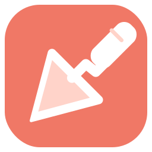
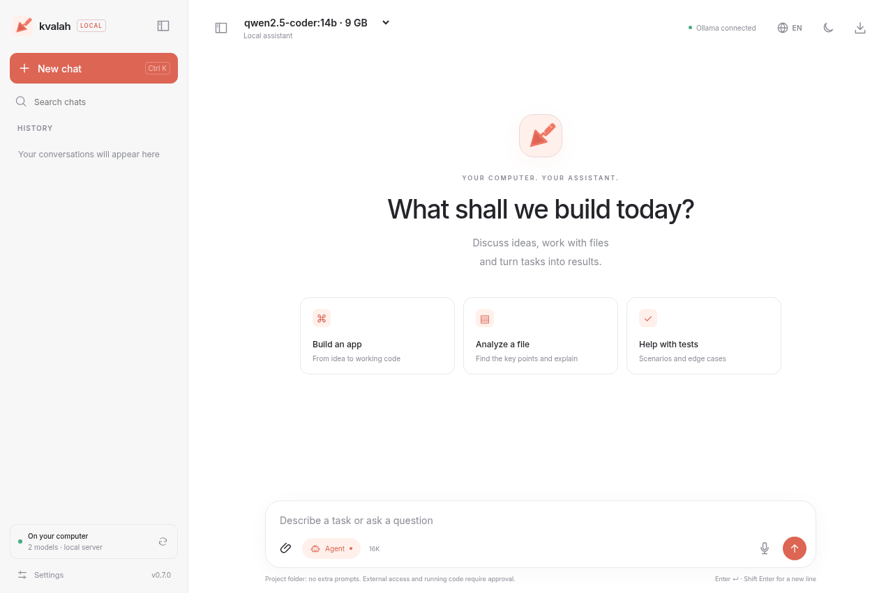
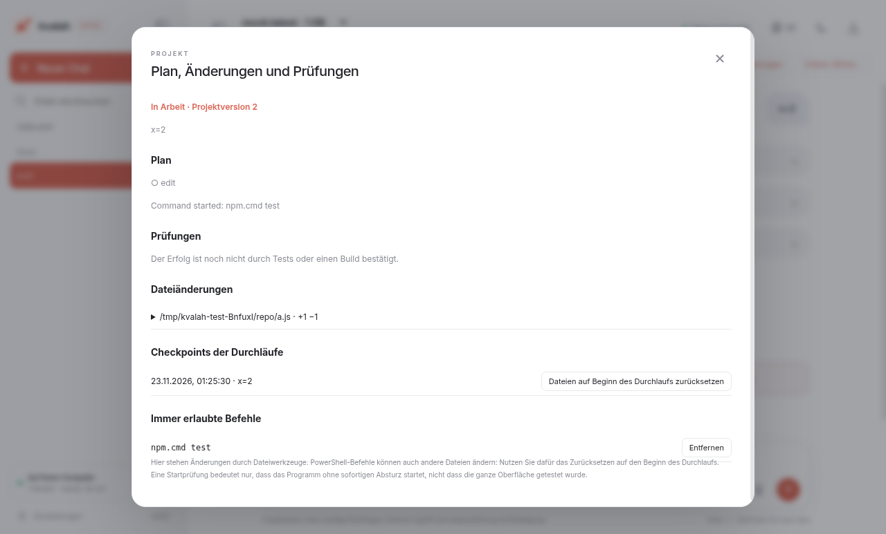

<p align="center"></p>

<h1 align="center">kvalah</h1>

<p align="center"><b>A reliable coding agent for 7–32B open models on a single home GPU.</b><br>
Ollama · LM Studio · llama.cpp · vLLM — Windows, macOS, Linux</p>

<p align="center">
<a href="https://github.com/AranAragan/kvalah/releases/latest"></a>
<a href="https://github.com/AranAragan/kvalah/actions/workflows/ci.yml"></a>
<a href="LICENSE"></a>
</p>

<p align="center"><a href="README.ru.md">Русская версия</a></p>

<p align="center"></p>

Big cloud agents assume a frontier model and 64K+ of context. kvalah is built for the model you can actually run at home: a 7–32B open-weight model with 8–32K of context. It keeps the agent on rails — **inspect → plan → edit → verify** — and **refuses to call a task done until a real check (tests, build, run) has passed** on the current sources.

## Features

- **Works with any local model server.** Ollama natively; LM Studio, llama.cpp `llama-server`, vLLM, LocalAI, Jan through the OpenAI-compatible API.
- **Robust tool calling for small models.** Native tool calls when the model supports them, otherwise a text protocol. Accepts `<tool_call>`, `[TOOL_CALLS]`, Harmony and fenced JSON, and repairs broken JSON.
- **Cache-friendly context.** The prompt prefix stays stable between steps so the server's prompt cache is reused; older steps are compacted into a digest; token estimates are calibrated from server counts.
- **Open any folder or Git repository** as a project, or start in a fresh one. Honors `AGENTS.md` / `AGENTS.override.md`.
- **Code navigation:** `search_code` (ripgrep or a built-in fallback), `find_files` (glob), `outline_file` (symbols for JS/TS, Python, C#/Java/Kotlin, Go, Rust, C/C++, PowerShell, Markdown).
- **Safe edits:** exact-fragment `edit_file`, multi-file `apply_patch` (Codex `*** Begin Patch` or unified diff, validated before writing), `append_file`; CRLF and BOM preserved; full rewrites only after a complete read.
- **Checkpoints and rewind:** a shadow-Git snapshot before every agent turn (your `.git` is untouched), per-edit undo with conflict detection, real diffs in the project panel.
- **Approval modes:** *Ask*, *Auto* (read-only commands run freely) and *Full access*, plus “always allow” rules per project.
- **Git tools:** `git_status`, `git_diff`, `git_commit` (with confirmation).
- **Multiple devices** (any number, on your LAN): **Pool memory** splits one big GGUF model across several computers with llama.cpp RPC, so models too large for one machine still run; **Distribute tasks** runs independent sub-tasks (code search, review, per-file jobs) in parallel on other computers' models, with failover. Pairing by code, token-authenticated, LAN-only. See [docs/DISTRIBUTED.md](docs/DISTRIBUTED.md).
- **10 UI languages** (English, Русский, Українська, Deutsch, Français, Español, Português (Brasil), 简体中文, Türkçe, 日本語), auto-detected on first launch.
- **Auto-update** from GitHub Releases, with a quiet in-app notice — never a forced restart.

<p align="center"></p>

## Install

| Platform | How |
|---|---|
| Windows 10/11 x64 | [Installer `kvalah-<version>-win-x64-setup.exe`](https://github.com/AranAragan/kvalah/releases/latest) (per-user, no admin rights) · or `winget install AranAragan.Kvalah` · or Scoop (below) · or the portable zip |
| macOS 12+ (Intel / Apple Silicon) | [`kvalah-<version>-mac-arm64.dmg` / `-mac-x64.dmg`](https://github.com/AranAragan/kvalah/releases/latest) |
| Linux x64 | [`kvalah-<version>-linux-x86_64.AppImage`](https://github.com/AranAragan/kvalah/releases/latest) or the `.deb` package |

**Scoop**

```powershell
scoop bucket add kvalah https://github.com/AranAragan/kvalah
scoop install kvalah
```

**Checksums:** every release has `SHA256SUMS.txt`.

**Unsigned builds.** Until code signing is in place (see [Code signing policy](#code-signing-policy)):
- Windows SmartScreen may show “Windows protected your PC” → *More info* → *Run anyway*.
- macOS: the app is not notarized. Right-click the app → *Open*, or run `xattr -dr com.apple.quarantine /Applications/kvalah.app`.
- Linux AppImage: `chmod +x kvalah-*.AppImage`.

### Updates

The installed Windows app and the Linux AppImage check GitHub Releases at startup and every 6 hours, download the update in the background and show *“Update X is available — Restart and install”*. The update is applied only when you click the button or quit the app. The portable zip, `.deb` and unsigned macOS builds only show a notice with a download link. Turn checks off in **Settings → Check for updates automatically**, or check manually in **Help → Check for updates…**.

## Connect a model

kvalah needs a model server running locally (or on your LAN). Open **Settings → Model server**.

| Server | Setting | URL |
|---|---|---|
| [Ollama](https://ollama.com) | Ollama | `http://127.0.0.1:11434` |
| [LM Studio](https://lmstudio.ai) (Developer → Start server) | OpenAI-compatible | `http://127.0.0.1:1234/v1` |
| [llama.cpp](https://github.com/ggml-org/llama.cpp) `llama-server -m model.gguf -c 16384 --jinja` | OpenAI-compatible | `http://127.0.0.1:8080/v1` |
| [vLLM](https://docs.vllm.ai) `vllm serve <model> --enable-auto-tool-choice --tool-call-parser <parser>` | OpenAI-compatible | `http://127.0.0.1:8000/v1` |

- **API key** is optional (only for servers that require one); it is stored locally and never shown again in the UI.
- **Tool calls:** *Auto* uses native tool calls when the model supports them and the text protocol otherwise. Choose *Text protocol* for models that keep mangling the native format.
- **Context:** agent mode needs at least 8192 tokens; 16–32K is the sweet spot for 7–32B models. For Ollama, kvalah sets `num_ctx` itself.
- Good starting models: Qwen2.5-Coder 14B/32B, Qwen3 14B/32B, Devstral Small, GPT-OSS 20B, Mistral Small 24B.

**Several computers?** Settings → **Devices** pools memory across them for a model that doesn't fit on one machine (bigger, not faster; use Ethernet), or runs agent sub-tasks in parallel on them. See [docs/DISTRIBUTED.md](docs/DISTRIBUTED.md).

Optional: Git in `PATH` enables checkpoints and Git tools; `rg` (ripgrep) in `PATH` speeds up code search on large repositories.

## How it works

1. **Inspect** — the agent reads the tree, README/config files, scoped `AGENTS.md` and `git status`.
2. **Plan** — `update_plan` stores concrete steps and acceptance checks (`PLAN.md` / `STATUS.md`, or under `.kvalah/` if you already have such files).
3. **Edit** — file tools create checkpoints; every change has a diff and can be undone.
4. **Verify** — `verify_project` runs a real command and records a fingerprint of the sources it checked. `finish_task` refuses missing, failed or stale evidence.

Shell commands run with your user's permissions after the approval policy; this is **not an OS sandbox**. Read [SECURITY.md](SECURITY.md).

## Build from source

Requirements: Node.js 22+ and Git.

```bash
git clone https://github.com/AranAragan/kvalah.git
cd kvalah
npm ci
npm test               # unit + end-to-end tests with a mock model server
npm run desktop        # run the Electron app
npm start              # or: backend only, open the printed URL in a browser
```

Packages (output in `release/`):

```bash
npm run dist:linux     # AppImage + deb
npm run dist:win       # NSIS installer + portable zip (on Linux/macOS needs wine for NSIS)
npm run dist:mac       # dmg + zip, x64 + arm64 (macOS only)
```

Releases are built by GitHub Actions when a `v*` tag is pushed: see [docs/PUBLISHING.md](docs/PUBLISHING.md) (in Russian) and [.github/workflows/release.yml](.github/workflows/release.yml).

Data locations: settings, chats and logs are in the Electron user-data folder (`%APPDATA%\kvalah`, `~/Library/Application Support/kvalah`, `~/.config/kvalah`); new projects go to `Documents/kvalah`.

## Code signing policy

Windows releases are built and signed exclusively by the [release workflow](.github/workflows/release.yml) from this repository's source; the signing setup is described in [docs/SIGNING.md](docs/SIGNING.md).

Free code signing provided by [SignPath.io](https://about.signpath.io), certificate by [SignPath Foundation](https://signpath.org) *(applies once the project is accepted into the SignPath Foundation program; until then releases are unsigned)*.

- Committers and reviewers: [Enver Abdullaev (@AranAragan)](https://github.com/AranAragan)
- Approvers: [Enver Abdullaev (@AranAragan)](https://github.com/AranAragan)

Every signing request is approved manually; only binaries built by GitHub Actions from a tagged commit of this repository are signed.

### Privacy policy

This program will not transfer any information to other networked systems unless specifically requested by the user or the person installing or operating it. In particular:

- prompts, files and tool results are sent only to the model server **you** configure (by default a server on your own computer);
- the update check contacts GitHub (`api.github.com`, `github.com`, `objects.githubusercontent.com`) to read the latest release and download it; it sends no personal data beyond what any HTTPS request contains (IP address, app version in the User-Agent). It can be turned off in Settings;
- **Devices** (off by default): only after you turn on *Share this device*, kvalah listens on your local network and answers discovery broadcasts. Paired devices receive the prompts and file contents of the sub-tasks you send them, and pooled model weights are transferred to the pool's workers. *Download llama.cpp* fetches the build from `github.com/ggml-org/llama.cpp`;
- there is no telemetry, analytics or crash reporting.

## Contributing

Issues and pull requests are welcome — see [CONTRIBUTING.md](CONTRIBUTING.md). Security issues: [SECURITY.md](SECURITY.md).

## License

[MIT](LICENSE) © 2026 Enver Abdullaev. Bundled third-party components keep their own licenses (Electron — MIT, pdf.js — Apache-2.0, electron-updater — MIT).
