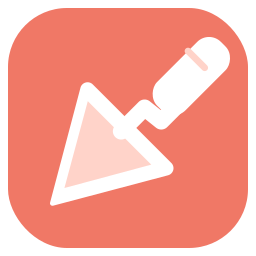
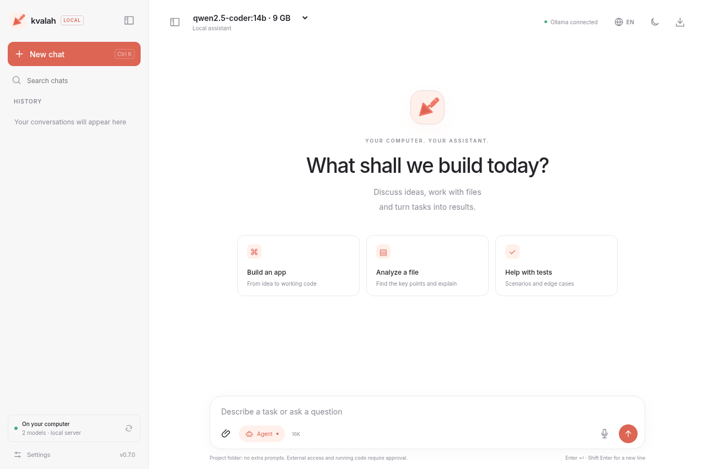

<p align="center"></p>

<h1 align="center">kvalah</h1>

<p align="center"><b>Надёжный агент для программирования на открытых моделях 7–32B с одной домашней видеокартой.</b><br>
Ollama · LM Studio · llama.cpp · vLLM — Windows, macOS, Linux</p>

<p align="center"><a href="README.md">English version</a></p>

<p align="center"></p>

Облачные агенты рассчитаны на топовые модели и контекст от 64K. kvalah сделан для модели, которую реально запустить дома: открытой модели на 7–32B параметров с контекстом 8–32K. Агент идёт по строгому циклу **изучить → спланировать → править → проверить** и **не объявляет задачу готовой, пока реальная проверка (тесты, сборка, запуск) не прошла** на текущих исходниках.

## Возможности

- **Любой локальный сервер моделей:** Ollama напрямую; LM Studio, `llama-server` из llama.cpp, vLLM, LocalAI, Jan — через OpenAI-совместимый API.
- **Надёжные вызовы инструментов для небольших моделей:** нативные tool calls, если модель их поддерживает, иначе текстовый протокол. Понимает `<tool_call>`, `[TOOL_CALLS]`, Harmony и JSON в блоках кода, чинит сломанный JSON.
- **Контекст, дружелюбный к кэшу:** начало промпта не меняется между шагами, поэтому сервер переиспользует кэш промпта; старые шаги сжимаются в сводку.
- **Любая папка или Git-репозиторий** как проект. Учитывает `AGENTS.md` / `AGENTS.override.md`.
- **Навигация по коду:** `search_code` (ripgrep или встроенный поиск), `find_files`, `outline_file`.
- **Аккуратные правки:** `edit_file` по точному фрагменту, `apply_patch` на несколько файлов с проверкой до записи, `append_file`; CRLF и BOM сохраняются.
- **Контрольные точки и откат:** снимок в теневом Git перед каждым ходом (ваш `.git` не трогается), отмена отдельной правки, настоящие диффы.
- **Режимы подтверждения:** «Спрашивать», «Авто», «Полный доступ» и правила «Всегда разрешать».
- **Несколько устройств** (сколько угодно, в локальной сети): **Общая память** делит одну большую GGUF-модель между компьютерами через llama.cpp RPC, чтобы запускать модели, которые не помещаются на одну машину; режим **Распределять задачи** выполняет независимые подзадачи (поиск по коду, ревью, обработка файлов) параллельно на моделях других компьютеров с переключением при сбое. Сопряжение по коду, доступ по токену, только локальная сеть. По шагам: [Несколько компьютеров: пошаговая настройка](#несколько-компьютеров-пошаговая-настройка); техническое описание: [docs/DISTRIBUTED.md](docs/DISTRIBUTED.md).
- **10 языков интерфейса**, при первом запуске язык подбирается по системе.
- **Автообновление** из GitHub Releases с ненавязчивым уведомлением в приложении.

## Установка

| Система | Как |
|---|---|
| Windows 10/11 x64 | [Установщик `kvalah-<версия>-win-x64-setup.exe`](https://github.com/AranAragan/kvalah/releases/latest) (для текущего пользователя, без прав администратора) · `winget install AranAragan.Kvalah` · Scoop · портативный zip |
| macOS 12+ (Intel / Apple Silicon) | [`kvalah-<версия>-mac-arm64.dmg` / `-mac-x64.dmg`](https://github.com/AranAragan/kvalah/releases/latest) |
| Linux x64 | [`kvalah-<версия>-linux-x86_64.AppImage`](https://github.com/AranAragan/kvalah/releases/latest) или пакет `.deb` |

```powershell
scoop bucket add kvalah https://github.com/AranAragan/kvalah
scoop install kvalah
```

Установщик для Windows ставит программу в `%LOCALAPPDATA%\Programs\kvalah` — туда же, куда и прежний установщик, поэтому старая версия обновляется на месте. Чаты и настройки (`%APPDATA%\kvalah`) не затрагиваются.

**Пока сборки не подписаны** (см. [политику подписи кода](README.md#code-signing-policy)): в Windows SmartScreen может показать «Система Windows защитила ваш компьютер» → «Подробнее» → «Выполнить в любом случае»; для macOS см. [macOS по шагам](#macos-по-шагам).

### macOS по шагам

1. Узнайте процессор:  → «Об этом Mac». **Apple M1/M2/M3/M4** — скачайте `kvalah-<версия>-mac-arm64.dmg`; **Intel** — `kvalah-<версия>-mac-x64.dmg` со страницы [Releases](https://github.com/AranAragan/kvalah/releases/latest).
2. Откройте `.dmg` и перетащите **kvalah** в папку **Программы**.
3. Первый запуск: приложение пока не нотаризовано, поэтому macOS скажет, что не может проверить разработчика. Варианты:
   - попробуйте открыть kvalah один раз, затем **Системные настройки → Конфиденциальность и безопасность**, пролистайте вниз и нажмите **«Всё равно открыть»** (в macOS 14 и старше также работает правый клик по приложению → «Открыть»), или
   - выполните в Терминале `xattr -cr /Applications/kvalah.app` и запустите снова.
4. Установите движок для моделей, например [Ollama](https://ollama.com/download), и скачайте модель: `ollama pull qwen2.5-coder:14b` (16 ГБ памяти) или `ollama pull qwen2.5-coder:7b` (8 ГБ). kvalah найдёт Ollama сам.
5. Обновления: начиная с 0.8.2 kvalah обновляется на macOS сам. Он скачивает новую версию в фоне и показывает *«Перезапустить и установить»*; приложение должно лежать в **Программах** (а не запускаться из образа диска или «Загрузок»), а если эта папка недоступна для записи, macOS попросит пароль администратора. **С 0.8.1 и более старых версий 0.8.2 нужно один раз установить вручную** (`.dmg` поверх старого приложения); дальше обновления приходят автоматически. Чаты и настройки сохраняются.

### Обновления

Установленная версия для Windows и AppImage для Linux проверяют GitHub Releases при запуске и каждые 6 часов, скачивают обновление в фоне и показывают *«Доступно обновление X — Перезапустить и установить»*. Установка — только по кнопке или при выходе из программы. Неподписанная сборка для macOS (с 0.8.2) делает то же самое своим обновлятором: скачивает zip для вашего Mac, проверяет SHA-512/SHA-256, по кнопке заменяет `kvalah.app` на месте, перезапускает его и откатывается, если новая версия не запустилась. Портативный zip и `.deb` показывают только уведомление со ссылкой на скачивание. Отключить: **Настройки → Проверять обновления автоматически**; проверить вручную: **Помощь → Проверить обновления…**.

## Подключение модели

**Настройки → Сервер моделей:**

| Сервер | Настройка | Адрес |
|---|---|---|
| Ollama | Ollama | `http://127.0.0.1:11434` |
| LM Studio | OpenAI-совместимый | `http://127.0.0.1:1234/v1` |
| llama.cpp `llama-server -m model.gguf -c 16384 --jinja` | OpenAI-совместимый | `http://127.0.0.1:8080/v1` |
| vLLM `vllm serve <модель> --enable-auto-tool-choice --tool-call-parser <парсер>` | OpenAI-совместимый | `http://127.0.0.1:8000/v1` |

**Несколько компьютеров?** Настройки → **Устройства**: общая память для модели, которая не помещается на один компьютер (больше, но не быстрее; лучше по кабелю Ethernet), или параллельное выполнение подзадач агента. Пошаговая инструкция — [ниже](#несколько-компьютеров-пошаговая-настройка), технические подробности — [docs/DISTRIBUTED.md](docs/DISTRIBUTED.md).

Для режима агента нужен контекст от 8192 токенов, оптимально 16–32K. Если модель путает формат вызовов, выберите «Вызов инструментов → Текстовый протокол». Git в `PATH` включает контрольные точки, `rg` ускоряет поиск.

## Несколько компьютеров: пошаговая настройка

Здесь по шагам описано, как настроить **Общую память** (одна большая модель на нескольких компьютерах) и **Распределять задачи** (подзадачи агента параллельно на других компьютерах). Названия кнопок и пунктов совпадают с интерфейсом. Технические подробности (протокол, распределение, безопасность, переменные окружения) — в [docs/DISTRIBUTED.md](docs/DISTRIBUTED.md) (на английском).

Термины: **главный компьютер** — тот, за которым вы работаете, где идёт чат и работает агент. **Узел** — компьютер, который отдаёт главному свою модель, видеокарту или ОЗУ. Узлов может быть сколько угодно.

### 1. Что нужно

- **Одна и та же версия kvalah на всех компьютерах**, 0.8.5 или новее. Обновите все до сопряжения.
- **Одна локальная сеть.** Все устройства в одной LAN. Автоматический поиск работает только в пределах одной подсети; между подсетями (VLAN, второй роутер, гостевой Wi-Fi) добавляйте устройства вручную по IP.
- **Лучше проводной Ethernet**, 1 Гбит/с или быстрее. По Wi-Fi работает, но общая память по Wi-Fi медленная. Для распределения задач Wi-Fi подходит.
- **Два Mac можно соединить кабелем Thunderbolt** — он работает как сеть. Подключите кабель и используйте адрес Thunderbolt Bridge (Системные настройки → Сеть → Thunderbolt Bridge, обычно `169.254.x.x`) в **Добавить вручную**.
- **На Mac с Apple Silicon (M1–M4) нужна версия для Apple Silicon**: `kvalah-<версия>-mac-arm64.dmg`. Версия для Intel (`mac-x64`) работает через Rosetta, и llama.cpp тогда не может использовать Metal. С 0.8.5 kvalah сам это замечает, скачивает правильный llama.cpp и предлагает переключить приложение на arm64, но проще сразу поставить arm64-dmg.
- Для общей памяти: **llama.cpp сборки b12651** на главном компьютере и на каждом узле (kvalah скачивает его сам, см. ниже).

### 2. Настройка каждого узла

На каждом узле откройте **Настройки → Устройства → Открыть «Устройства»…** (или **kvalah → Устройства…** в меню приложения), вкладка **Это устройство**:

1. Включите **Открыть доступ к этому устройству**.
2. Задайте **Имя устройства** (его увидит главный компьютер) и при необходимости **Порт** (по умолчанию **47317**).
3. Запомните **Код сопряжения** на вкладке, например `K7QM-2D9X-HF4R`. **Новый код** создаёт другой. В **Адреса** перечислены адреса этого компьютера; статус должен быть **Ожидает подключений**.
4. Выберите, что отдаёт этот компьютер:
   - **Выполнять задачи для сопряжённых устройств** — главный компьютер сможет использовать модель этого компьютера (Ollama или другой локальный сервер) для подзадач. Облачные API-ключи никогда не передаются.
   - **Узел общей памяти (RPC-сервер llama.cpp)** — отдаёт видеопамять и ОЗУ этого компьютера под общую модель, запущенную на другом устройстве. На вкладке появится **RPC-сервер работает**.
5. Для общей памяти установите llama.cpp в карточке **llama.cpp**: оставьте **Бэкенд** на **Автоматически** (Metal на Mac, Vulkan на остальных) или выберите **Vulkan (NVIDIA, AMD, Intel)**, **CUDA (NVIDIA)** или **Только CPU** и нажмите **Скачать**. После загрузки карточка показывает **Установлено: сборка b12651, …**. На Mac там должно быть `metal` и `arm64`; на Windows/Linux с видеокартой — `vulkan` или `cuda`, а не `cpu`. На всех устройствах нужна одна сборка (b12651).
6. Разрешите kvalah в брандмауэре, когда он спросит, **только для частных сетей**. Порты: **TCP 47317** (сопряжение, задачи, общая память) и **UDP 47318** (поиск).
   - **Windows:** у сети должен быть профиль **Частная** (Параметры → Сеть и Интернет → ваш Ethernet или Wi-Fi → Тип сетевого профиля → Частная). В *Общедоступной* сети брандмауэр блокирует kvalah, даже если вы его разрешили.
   - **macOS:** на вопрос о входящих подключениях ответьте **Разрешить**. Если нажали «Отклонить», исправьте в Системных настройках → Сеть → Брандмауэр → Параметры.
   - **Linux:** если включён брандмауэр, откройте порты, например `sudo ufw allow from 192.168.0.0/16 to any port 47317 proto tcp` и так же для `47318 proto udp`.

Позже в разделе **Сопряжено с** узел показывает подключившиеся главные компьютеры; **Отозвать** отключает любой из них.

### 3. Сопряжение узлов на главном компьютере

На главном компьютере откройте **Устройства → Устройства в сети**:

1. В **Найдено в сети** узлы появляются автоматически (**Искать** — поискать ещё раз). Введите **Код сопряжения** узла и нажмите **Подключить**. Появится «Устройство подключено».
2. Если узел не находится (другая подсеть, Thunderbolt Bridge, строгий брандмауэр), используйте **Добавить вручную**: **Тип** → **kvalah (сопряжение)**, **Адрес** → `192.168.1.20:47317` (адрес узла из **Адреса**), **Код сопряжения**, затем **Добавить**.
3. У каждого сопряжённого устройства есть строка со статусом (**В сети**, задержка, модели, нагрузка) и две галочки:
   - **Задачи** — использовать устройство для подзадач. Можно выбрать модель (**Та же модель, что здесь** или конкретную) и **Задач одновременно**.
   - **Память** — использовать устройство в общей памяти. В строке видно **RPC готов**, когда на узле работает RPC-сервер, иначе **RPC выключен**.
4. **Проверить** заново проверяет все устройства. **Удалить** убирает устройство; потом его придётся сопрягать заново.

Как устройство для задач можно добавить и отдельную **Ollama** (она должна слушать сеть: `OLLAMA_HOST=0.0.0.0`) или **OpenAI-совместимый сервер**. У них нет пароля — добавляйте их только в доверенной сети; сопряжение через kvalah безопаснее.

### 4. Распределять задачи

На главном компьютере во вкладке **Устройства в сети** включите **Распределять задачи** и отметьте **Задачи** у нужных устройств. **Этот компьютер** задаёт, сколько берёт на себя сам главный компьютер: **Только как запасной вариант**, **1 задача одновременно** или **2 задачи одновременно**.

Пока режим включён, у агента есть два дополнительных инструмента:

- **`parallel_tasks`** — до 8 независимых подзадач (найти использования, сделать ревью модуля, поискать недостающие тесты…). Каждая выполняется помощником только для чтения на модели другого устройства; файлы читаются на главном компьютере. Отчёты возвращаются по порядку.
- **`batch_files`** — одна инструкция для множества файлов (до 300, списком или по маске) в режиме `report` (ответ по каждому файлу) или `edit` (устройства предлагают новое содержимое, главный компьютер применяет правки по одной с контрольными точками и отменой и отказывается трогать файлы, изменённые за это время).

Агент сам решает, когда их использовать, но можно попросить прямо, например:

- «Через parallel_tasks отдельно сделай ревью `src/server`, `src/ui` и `src/storage` на ошибки и сведи результаты».
- «Через batch_files в режиме report пройди по `src/**/*.ts` и перечисли экспортируемые функции без тестов».
- «Через batch_files в режиме edit исправь в `docs/*.md` только опечатки, больше ничего не меняй».

Переключение при сбое: подзадача уходит на наименее загруженное исправное устройство. Если устройство не ответило, вернуло ошибку или пропало из сети, подзадача повторяется на другом (до 4 попыток), последний вариант — **Этот компьютер**. Устройство, которое ошиблось 3 раза подряд, помечается **Не в сети** до следующей успешной проверки. Правки, команды и итоговые проверки (`verify_project`) всегда остаются на главном компьютере.

### 5. Общая память (одна модель на нескольких компьютерах)

Перед началом: на каждом узле включён **Узел общей памяти** и установлен llama.cpp b12651; на главном компьютере тоже установлен llama.cpp b12651, а у этих узлов отмечено **Память**.

На главном компьютере откройте **Устройства → Общая память**:

1. **Устройства в пуле**: отметьте узлы и, если на главном компьютере есть видеокарта, **Видеокарта этого компьютера**. В строках видна свободная память (на Mac — оценка со знаком ≈, потому что видеокарта делит ОЗУ) и *используется* / *не используется*.
2. **Модель**: выберите модель в **Из Ollama** — kvalah сам найдёт её файл GGUF в хранилище Ollama и подставит путь. Если список пуст или устарел, нажмите ↻ (**Обновить список**). Или укажите **Или файл GGUF** через **Обзор…**. Файл модели нужен только на главном компьютере: веса передаются узлам при запуске пула.
3. **Контекст**: начните с 16384–32768. Больший контекст требует больше памяти на каждом устройстве.
4. Нажмите **Запустить пул**. Статус меняется так: **Подключение к устройствам…** → **Загрузка модели на устройства…** → **Работает: …**. Строка **Трафик** показывает, сколько отправлено узлам; первая загрузка модели на 30 ГБ по сети 1 Гбит/с занимает несколько минут. **Журнал** показывает вывод llama-server.
5. Нажмите **Использовать для агента**. Надпись сменится на **Агент использует пул**, и чаты пойдут через общую модель.
6. **Остановить пул** останавливает его и возвращает агенту прежний сервер моделей.

Правила и ожидания:

- **Один пул на набор видеокарт.** Узел, на котором запущен собственный пул, показывает **Видеокарты заняты локальным пулом**; компьютер, чья видеокарта отдана другому главному компьютеру, предупреждает перед запуском своего пула, потому что оба делили бы одну память.
- **Больше модели — но не быстрее.** Каждый сгенерированный токен проходит через сеть, поэтому пул обычно медленнее одного устройства. Используйте его, когда модель не помещается на один компьютер.
- Пул обслуживает один разговор за раз и не используется для распределённых подзадач.

### 6. Решение проблем

| Что видно | Что делать |
|---|---|
| Узла нет в **Найдено в сети** | Проверьте, что включено **Открыть доступ к этому устройству** и статус **Ожидает подключений**, оба компьютера в одной подсети, брандмауэр разрешает kvalah в частных сетях (Windows: профиль сети **Частная**). Иначе — **Добавить вручную** с адресом из **Адреса**. |
| **Устройство … недоступно.** / **Не в сети** | Узел спит, kvalah на нём закрыт, сменился адрес (DHCP) или брандмауэр блокирует TCP 47317. Нажмите **Проверить**; если адрес сменился — **Удалить** устройство и подключить заново. |
| **Неверный код сопряжения.** / **Слишком много неверных кодов. Попробуйте через 10 минут.** | Скопируйте код со вкладки **Это устройство** на узле. После 5 неверных кодов сопряжение блокируется на 10 минут. |
| Список **Из Ollama** пуст (**В … не найдено моделей Ollama** или **Ollama не запущена на …**) | Запустите Ollama и нажмите ↻ (**Обновить список**). Если вы переносили модели Ollama, задайте `OLLAMA_MODELS` с этой папкой (или проверьте **Настройки → Адрес Ollama**) либо выберите файл через **Обзор…**: модель — самый большой файл `sha256-…` в папке `blobs`. |
| **Выберите модель из Ollama или файл GGUF.** / **Файл GGUF не найден: …** | Выберите модель в списке или существующий файл `.gguf` через **Обзор…**; путь должен быть полным путём на главном компьютере. |
| Mac: **llama.cpp не нашёл GPU Metal на этом Mac (устройства: BLAS (Accelerate))**, у Mac написано *не используется* | Версия kvalah для Intel работает через Rosetta и поставила llama.cpp для x64, в котором нет Metal. Установите `kvalah-<версия>-mac-arm64.dmg` (или согласитесь на переключение, которое предложит обновление), затем **Устройства → Это устройство → Скачать**. В карточке должно быть `metal · arm64`. |
| Зависло на **Загрузка модели на устройства…** | Через 3 минуты без нового вывода llama-server и без сетевого трафика пул показывает предупреждение с последними строками журнала, через 10 минут останавливается с ошибкой. Откройте **Журнал**, чтобы понять причину (не хватило памяти, модель не поддерживается, отвалился узел). |
| **На … llama.cpp …; на всех устройствах нужна одинаковая сборка.** | Обновите kvalah и нажмите **Скачать** на каждом устройстве, чтобы везде была b12651. |
| **OpenAI-совместимый сервер недоступен по адресу http://127.0.0.1:8080/v1** (или с другим портом) | Агент всё ещё настроен на пул, а пул остановлен. Запустите пул снова или переключите **Настройки → Сервер моделей** обратно на Ollama или ваш обычный сервер. |

### 7. Безопасность

- Пока не включено **Открыть доступ к этому устройству**, kvalah ничего не слушает в сети, и он принимает подключения только с частных (локальных) адресов.
- При сопряжении главный компьютер получает случайный токен; он нужен для каждого запроса и для RPC-туннеля. Узел может **Отозвать** его в любой момент. Пять неверных кодов блокируют сопряжение на 10 минут.
- **Трафик не шифруется:** промпты, содержимое файлов и веса модели идут по локальной сети в открытом виде. Используйте это только в доверенных сетях, никогда — в публичном или гостевом Wi-Fi.
- Узлы делятся только локальным сервером моделей и железом; облачные API-ключи не покидают компьютер.

## Сборка из исходников

```bash
git clone https://github.com/AranAragan/kvalah.git && cd kvalah
npm ci
npm test
npm run desktop        # запустить приложение
npm run dist:linux     # AppImage + deb в release/
npm run dist:win       # установщик NSIS + zip (на Linux/macOS для NSIS нужен wine)
npm run dist:mac       # dmg + zip (только на macOS)
```

Публикация релизов, winget и Scoop — [docs/PUBLISHING.md](docs/PUBLISHING.md); подпись кода — [docs/SIGNING.md](docs/SIGNING.md).

## Конфиденциальность

Программа не передаёт данные в сеть, если об этом не попросил пользователь: запросы, файлы и результаты инструментов уходят только на сервер моделей, который вы указали; проверка обновлений обращается к GitHub (отключается в настройках). Телеметрии нет.

## Лицензия

[MIT](LICENSE) © 2026 Enver Abdullaev.
